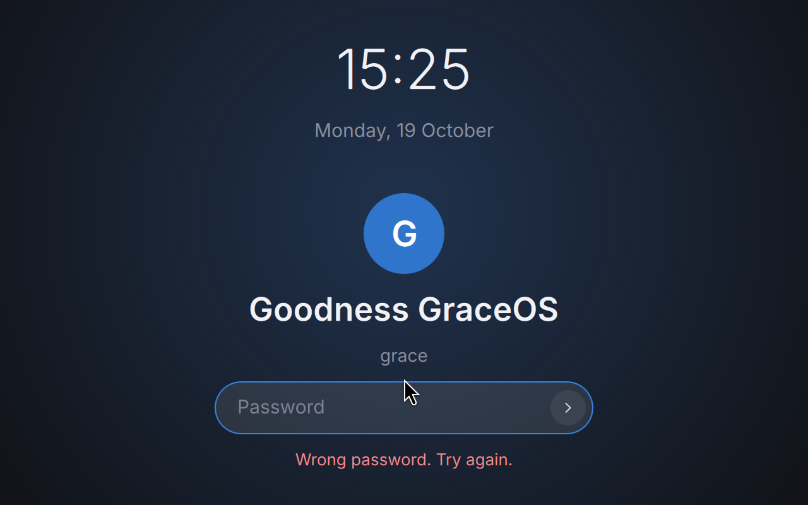
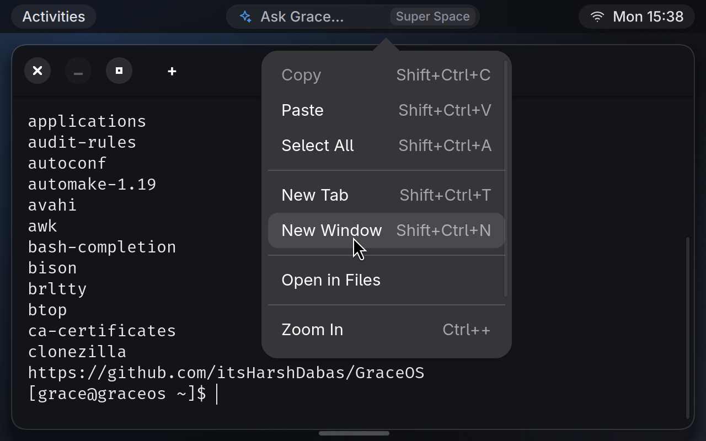
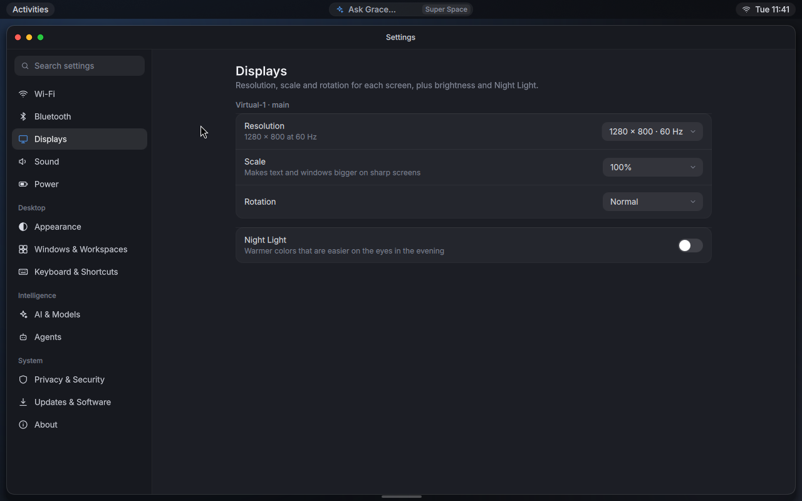
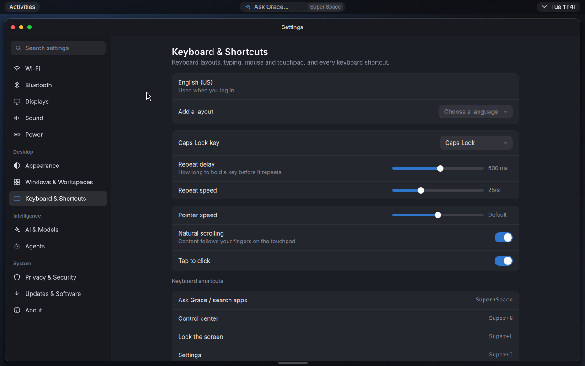

# Grace Candyland

The desktop of [GraceOS](https://github.com/itsHarshDabas/GraceOS): GNOME's calm look with Hyprland's tiling and compositor-level control, plus small, optional AI touches. It installs on any Linux distro that has Hyprland and Quickshell.

**Status: early preview.** The pieces listed under "What works" run in a real Hyprland session and were checked with screenshots and tests. Everything else is listed honestly under "Not built yet".







These screenshots come from a VMware VM without 3D acceleration (software rendering).

## What it is
- **Compositor:** [Hyprland](https://hypr.land), with Grace defaults. Windows auto-tile with one gap value everywhere, rounded corners, hairline edges, soft shadows and blur.
- **Shell:** [Quickshell](https://quickshell.org) (QML) in `shell/`. It provides the top bar, control center, launcher, dock, notifications, agent approvals and Settings.
- **One settings file:** `~/.config/grace/desktop.conf`. The Settings app edits it and so can you. Changes apply live, and Settings only rewrites the value it changes, so your comments stay.
- **Your own Hyprland config** goes in `~/.config/grace/hyprland.conf`. It loads last, so it wins. Themes, icon themes, cursors and Hyprland plugins from the AUR or anywhere else work as usual.

## What works
- **Top bar:**
  - Activities on the left.
  - "Ask Grace…" in the center (Super+Space).
  - Tray on the right: Wi-Fi, volume, battery and clock. It shows a dot while an agent approval is waiting.
- **Control center** (click the tray or press Super+N):
  - Battery or date, and Settings and Power buttons (Log out, Restart, Power off).
  - Six quick toggles: Wi-Fi, Bluetooth, Do Not Disturb, Dark Style, Power Mode and Night Light.
  - Volume and brightness sliders.
  - The Local AI card: master AI switch, the running Ollama model with Stop, and the agent waiting on you.
  - Notifications, with pending approvals pinned on top.
- **Ask Grace** (Super+Space) searches your apps. With AI on, the last row asks [CherryCola](https://github.com/itsHarshDabas/GraceOS/tree/main/services/cherrycola), GraceOS's local model (Ollama or LM Studio), and streams the answer into the panel. If the model isn't downloaded yet, it offers a button to download it. Set `ask_command` in `desktop.conf` to use something else.
- **Lock screen, "Goodness GraceOS":** Super+L, the Lock button in the control center, after 10 minutes idle (adjustable in Settings) and before sleep. It shows the time, the date, your name and a password field, and checks the password with PAM. It uses the compositor's session lock, so if the shell crashes while locked, the screen stays locked.
- **CandySole**, the GraceOS terminal (`apps/candysole`, GTK 4 + VTE): tabs, a right-click menu (Copy, Paste, Select All, New Tab, New Window, Open in Files, zoom), clickable links, Grace colors and Fira Code. `candysole -e CMD` runs a command.
- **Dock:** hidden until the pointer touches the bottom-middle edge. It shows real app icons, a dot under running apps, and pinned apps from `desktop.conf`.
- **Notifications:** banners at the top right for about 5 seconds. Do Not Disturb keeps them in the list without the banner.
- **Cortex Council** (the AI parliament, [its own repo](https://github.com/itsHarshDabas/Cortex-Council)): open it from Ask Grace or the app list and it opens in your browser, after starting its local server in the background if it isn't running yet. Right-click → Stop Cortex Council, or `grace-cortex stop`, stops it. It uses the `cortex-council` command (the GraceOS package, or `npm link` in a checkout); otherwise a checkout at `cortex_council` in `desktop.conf`, `~/Cortex-Council` or `~/cortex-council`. If it isn't installed, a notification says so.
- **Agent approvals:** `grace-approve AGENT COMMAND [CWD]` shows "Claude Code wants to run `npm install express` in ~/graceos" with Allow once, Deny and Details. See below.
- **Settings** (Super+I, or `grace-settings "Page name"`), every page working:
  - **Wi-Fi:** on/off, networks with signal and security, join with a password, disconnect, forget; nmtui for VPNs and the rest.
  - **Bluetooth:** on/off, your devices with battery level, connect/disconnect/forget, pair nearby devices.
  - **Displays:** resolution and refresh rate, scale, rotation and on/off per screen (saved to `~/.config/grace/monitors.conf`), brightness, Night Light and its warmth.
  - **Sound:** output and input device, their volume and mute, and the volume of each app playing.
  - **Power:** power mode, battery level and health, screen-off and automatic sleep timers.
  - **Appearance:** Light or Dark, nine accent colors, gaps, corner roundness, blur, animations, dock.
  - **Windows & Workspaces:** Auto-tile or Floating, tiling style (split or main + stack), snapping, focus follows mouse.
  - **Keyboard & Shortcuts:** layouts and the switch shortcut, Caps Lock behavior, key repeat, pointer speed, natural scrolling, tap to click, and every shortcut.
  - **AI & Models:** the AI switch, CherryCola's engine (Ollama or LM Studio), server start/stop, the model in use, download and remove models.
  - **Agents:** requests waiting for you, recent answers, which coding agents are installed, how to make one ask first.
  - **Privacy & Security:** lock timing, lock before sleep, what's using the microphone or camera, clear recent files, SSH on/off.
  - **Updates & Software:** check and install updates (Arch, GraceOS and the AUR), install a package, package counts.
  - **About:** OS, kernel, desktop, CPU, memory, graphics, disk, uptime; copy them for a bug report.
  - Things that need administrator rights (updates, SSH) open in a terminal so you can type your password; there's no polkit agent yet.
- **Low-end and VM friendly:**
  - Lite mode turns off blur, shadows and animations when Hyprland draws on the CPU or the PC has less than 4 GB of RAM.
  - If Hyprland can't start because there's no GPU acceleration, the session retries with software rendering.
  - On VMware with 3D on, Hyprland keeps the GPU but rejects apps' GPU buffers, so the shell and apps draw on the CPU there.

## Not built yet
- macOS-style title bars on every window. Hyprland doesn't draw title bars. GTK apps get their buttons on the left; other apps have none yet. The likely path is the `hyprbars` plugin.
- The inline AI hint in the terminal, and AI summaries of notifications.
- A polkit agent (password prompts for system actions), and a light theme for the shell itself. Light style only affects apps.
- Restarting the shell while the screen is locked leaves Hyprland's "lockscreen app died" page; unlock from another console (Ctrl+Alt+F3).

## Install

### Arch Linux
```
git clone https://github.com/itsHarshDabas/grace-candyland
cd grace-candyland/packaging/arch && makepkg -si
```

### Other distros
Install these with your package manager (or build them from source if yours are too old), then `make install`:

| Needed | Optional |
|---|---|
| Hyprland, hypridle, Quickshell, Qt 6 SVG, Inter and Fira Code fonts, Adwaita cursors, xdg-utils, make; for CandySole: Python GObject, GTK 4, libadwaita, VTE for GTK 4 | CherryCola (+ Ollama or LM Studio), NetworkManager, BlueZ, PipeWire + WirePlumber, UPower, power-profiles-daemon, brightnessctl, hyprsunset, grim, libnotify, xdg-desktop-portal-hyprland |

```
sudo make install            # PREFIX=/usr by default; DESTDIR is supported for packaging
```

It's tested with **Hyprland 0.56.2 and Quickshell 0.3.2** on Arch. The Hyprland config uses the current window-rule syntax (`blur on, match:namespace …`), which older Hyprland releases don't understand.

## Use it
Pick **Grace Candyland** in your display manager, or run `grace-candyland` from a text console.

| Keys | Action |
|---|---|
| Super+Space | Ask Grace / search apps |
| Super+N | Control center |
| Super+L | Lock the screen |
| Super+I | Settings |
| Super+Return or Super+T | Terminal (CandySole) |
| Super+E | Files |
| Super+Q | Close window |
| Super+F / Super+M | Fullscreen / maximize |
| Super+V | Float or tile the window |
| Super+arrows, Super+Shift+arrows | Move focus / move window |
| Super+1…9, Super+Shift+1…9 | Go to workspace / send window there |
| Super+drag (left / right button) | Move / resize |
| Print | Screenshot to Pictures/Screenshots |
| Super+Shift+Q | Log out |

## desktop.conf
The default file (copied on first start) documents every key: `style`, `accent`, `gaps`, `rounding`, `blur`, `layout`, `animations`, `dock`, `ai`, `dnd`, `night_light`, `pinned`, and the optional `terminal`, `wallpaper`, `ask_command` and `cortex_council`. Settings also writes `tiling`, `snap`, `follow_mouse`, `kb_layout`, `layout_switch`, `caps_lock`, `repeat_delay`, `repeat_rate`, `pointer_speed`, `natural_scroll`, `tap_to_click`, `lock_after`, `lock_before_sleep`, `screen_off_after`, `suspend_after` and `night_light_temp`. Keyboard, pointer and window options are only pushed to Hyprland once Settings (or you) set them, so the same options in `~/.config/grace/hyprland.conf` keep working.

## Agent approvals
```
grace-approve "Claude Code" "npm install express" ~/graceos && npm install express
```
- **Exit status:** 0 means allowed once and 1 means denied. 2 means it couldn't ask, for example because the shell isn't running; treat that as denied.
- A request waits until you answer. Nothing approves on a timeout, and no keyboard shortcut answers it.
- The prompt shows text exactly as sent. Control, bidi and zero-width characters appear as `\uXXXX`. Allow once stays disabled until the whole command is visible; for long commands, open Details first.
- The shell chooses where the answer goes from a validated request id; a caller can't redirect it to another path.
- **Limitation:** the answer travels through a FIFO under `$XDG_RUNTIME_DIR/grace/approvals` that only your user can open. That stops other users, but not a program already running as you. Real enforcement needs agents to run as a separate user or in a sandbox, which is planned in GraceOS.

## Develop
```
qs -p shell                    # run the shell from the checkout inside a Hyprland session
make check                     # shellcheck + Hyprland --verify-config
sh tests/approve.sh            # grace-approve round trip against the running shell
```
- `shell/config/`: settings file and design tokens.
- `shell/services/`: compositor sync, approvals, notifications, system status.
- `shell/widgets/`: shared controls and the line icons.
- `shell/modules/`: bar, control center, launcher, dock, popups, lock screen, Settings, wallpaper.
- `apps/candysole/`: the terminal (`python -m pytest apps/candysole` tests its helpers).

The design is in the GraceOS repo: `docs/design/2026-10-19-grace-shell-design.md`.

## License
Not chosen yet. It's tracked with the GraceOS license decision.
