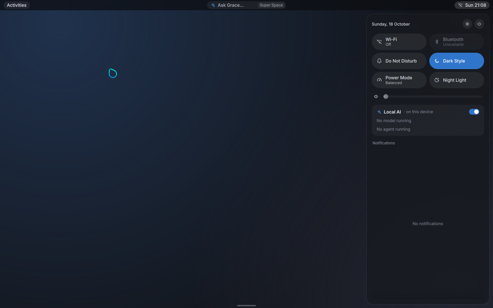
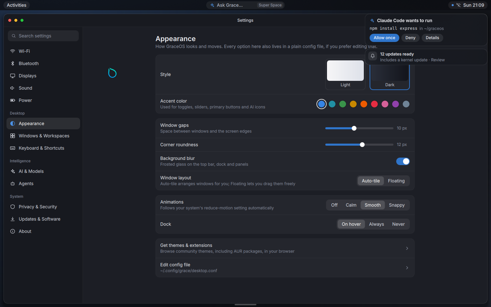

# Grace Candyland

The desktop of [GraceOS](https://github.com/itsHarshDabas/GraceOS): GNOME's calm look with Hyprland's tiling and compositor-level control, plus small, optional AI touches. It installs on any Linux distro that has Hyprland and Quickshell.

**Status: early preview.** The pieces listed under "What works" run in a real Hyprland session and were checked with screenshots and tests. Everything else is listed honestly under "Not built yet".




These screenshots come from a VMware VM without 3D acceleration (software rendering).

## What it is
- **Compositor:** [Hyprland](https://hypr.land), with Grace defaults. Windows auto-tile with one gap value everywhere, rounded corners, hairline edges, soft shadows and blur.
- **Shell:** [Quickshell](https://quickshell.org) (QML) in `shell/`. It provides the top bar, control center, launcher, dock, notifications, agent approvals and Settings.
- **One settings file:** `~/.config/grace/desktop.conf`. The Settings app edits it and so can you. Changes apply live, and Settings only rewrites the value it changes, so your comments stay.
- **Your own Hyprland config** goes in `~/.config/grace/hyprland.conf`. It loads last, so it wins. Themes, icon themes, cursors and Hyprland plugins from the AUR or anywhere else work as usual.

## What works
- **Top bar:**
  - Activities on the left.
  - "Ask Grace…" in the center (Super+Space).
  - Tray on the right: Wi-Fi, volume, battery and clock. It shows a dot while an agent approval is waiting.
- **Control center** (click the tray or press Super+N):
  - Battery or date, and Settings and Power buttons (Log out, Restart, Power off).
  - Six quick toggles: Wi-Fi, Bluetooth, Do Not Disturb, Dark Style, Power Mode and Night Light.
  - Volume and brightness sliders.
  - The Local AI card: master AI switch, the running Ollama model with Stop, and the agent waiting on you.
  - Notifications, with pending approvals pinned on top.
- **Ask Grace** (Super+Space) searches your apps. With AI on, the last row sends the question to `ask_command` from `desktop.conf`. If none is set, it says so.
- **Dock:** hidden until the pointer touches the bottom-middle edge. It shows real app icons, a dot under running apps, and pinned apps from `desktop.conf`.
- **Notifications:** banners at the top right for about 5 seconds. Do Not Disturb keeps them in the list without the banner.
- **Agent approvals:** `grace-approve AGENT COMMAND [CWD]` shows "Claude Code wants to run `npm install express` in ~/graceos" with Allow once, Deny and Details. See below.
- **Settings → Appearance:**
  - Style (Light or Dark, for apps) and nine accent colors.
  - Window gaps, corner roundness, background blur, and Auto-tile or Floating.
  - Animations (Off, Calm, Smooth or Snappy), which also follow the system's reduce-motion setting.
  - Dock behavior.
  - Links to get themes and to edit the config file.
- **Startup fallback:** if Hyprland can't start because there's no GPU acceleration, the session retries with software rendering.

## Not built yet
- macOS-style title bars on every window. Hyprland doesn't draw title bars. GTK apps get their buttons on the left; other apps have none yet. The likely path is the `hyprbars` plugin.
- Settings pages other than Appearance. They're listed, but they say they aren't ready.
- The inline AI hint in the terminal, and AI summaries of notifications.
- Lock screen, idle handling, a polkit agent, and a light theme for the shell itself. Light style only affects apps.

## Install

### Arch Linux
```
git clone https://github.com/itsHarshDabas/grace-candyland
cd grace-candyland/packaging/arch && makepkg -si
```

### Other distros
Install these with your package manager (or build them from source if yours are too old), then `make install`:

| Needed | Optional |
|---|---|
| Hyprland, Quickshell, Qt 6 SVG, Inter font, Adwaita cursors, xdg-utils, make | a terminal (foot is the default), Fira Code, NetworkManager, BlueZ, PipeWire + WirePlumber, UPower, power-profiles-daemon, brightnessctl, hyprsunset, grim, libnotify, xdg-desktop-portal-hyprland, Ollama |

```
sudo make install            # PREFIX=/usr by default; DESTDIR is supported for packaging
```

It's tested with **Hyprland 0.56.2 and Quickshell 0.3.2** on Arch. The Hyprland config uses the current window-rule syntax (`blur on, match:namespace …`), which older Hyprland releases don't understand.

## Use it
Pick **Grace Candyland** in your display manager, or run `grace-candyland` from a text console.

| Keys | Action |
|---|---|
| Super+Space | Ask Grace / search apps |
| Super+N | Control center |
| Super+I | Settings |
| Super+Return or Super+T | Terminal |
| Super+E | Files |
| Super+Q | Close window |
| Super+F / Super+M | Fullscreen / maximize |
| Super+V | Float or tile the window |
| Super+arrows, Super+Shift+arrows | Move focus / move window |
| Super+1…9, Super+Shift+1…9 | Go to workspace / send window there |
| Super+drag (left / right button) | Move / resize |
| Print | Screenshot to Pictures/Screenshots |
| Super+Shift+Q | Log out |

## desktop.conf
The default file (copied on first start) documents every key: `style`, `accent`, `gaps`, `rounding`, `blur`, `layout`, `animations`, `dock`, `ai`, `dnd`, `night_light`, `pinned`, and the optional `terminal`, `wallpaper` and `ask_command`.

## Agent approvals
```
grace-approve "Claude Code" "npm install express" ~/graceos && npm install express
```
- **Exit status:** 0 means allowed once and 1 means denied. 2 means it couldn't ask, for example because the shell isn't running; treat that as denied.
- A request waits until you answer. Nothing approves on a timeout, and no keyboard shortcut answers it.
- The prompt shows text exactly as sent. Control, bidi and zero-width characters appear as `\uXXXX`. Allow once stays disabled until the whole command is visible; for long commands, open Details first.
- The shell chooses where the answer goes from a validated request id; a caller can't redirect it to another path.
- **Limitation:** the answer travels through a FIFO under `$XDG_RUNTIME_DIR/grace/approvals` that only your user can open. That stops other users, but not a program already running as you. Real enforcement needs agents to run as a separate user or in a sandbox, which is planned in GraceOS.

## Develop
```
qs -p shell                    # run the shell from the checkout inside a Hyprland session
make check                     # shellcheck + Hyprland --verify-config
sh tests/approve.sh            # grace-approve round trip against the running shell
```
- `shell/config/`: settings file and design tokens.
- `shell/services/`: compositor sync, approvals, notifications, system status.
- `shell/widgets/`: shared controls and the line icons.
- `shell/modules/`: bar, control center, launcher, dock, popups, Settings, wallpaper.

The design is in the GraceOS repo: `docs/design/2026-10-19-grace-shell-design.md`.

## License
Not chosen yet. It's tracked with the GraceOS license decision.
